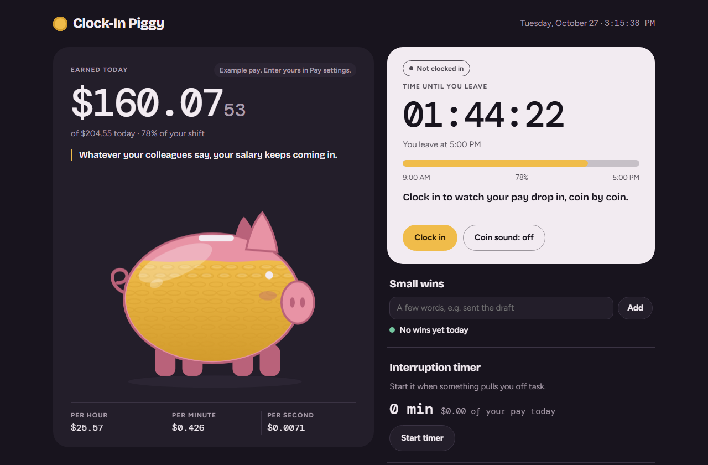

# Piggy Payroll

A small web page for the working day. Clock in when you start, and watch your pay drop into a glass piggy bank, coin by coin, while a countdown shows how long until you leave.

It is made for people close to burnout or tired of office politics. Whatever your colleagues say, your salary keeps coming in.

## Features

- **Live earnings.** Enter a monthly paycheck or a daily salary. The page works out your pay per hour, minute and second and fills the piggy as the shift goes on.
- **Countdown.** Time left until you leave, with a progress bar. After your end time it shows unpaid minutes and tells you to go home.
- **Small wins.** Type a few words about anything you moved forward. Each win drops a green coin into the piggy.
- **Politics timer.** Start it when the gossip starts and see how much of your paid day it takes.
- **Short wisdom lines.** A calm reminder that changes every 40 seconds.

## Use it

Open `index.html` in any browser. No install and no account. Your pay and times are stored only in your own browser and are never sent anywhere.

## Why it works

- Small wins lift motivation the most. [Amabile and Kramer, 2011](https://hbr.org/2011/05/the-power-of-small-wins)
- Switching off after work helps recovery. [Sonnentag and Fritz, 2007](https://doi.org/10.1037/1076-8998.12.3.204)
- Burnout means exhaustion, cynicism and feeling ineffective. [Maslach and Leiter, 2016](https://doi.org/10.1002/wps.20311)

This is a nudge, not treatment. If work drains you most days, talk to a doctor.
